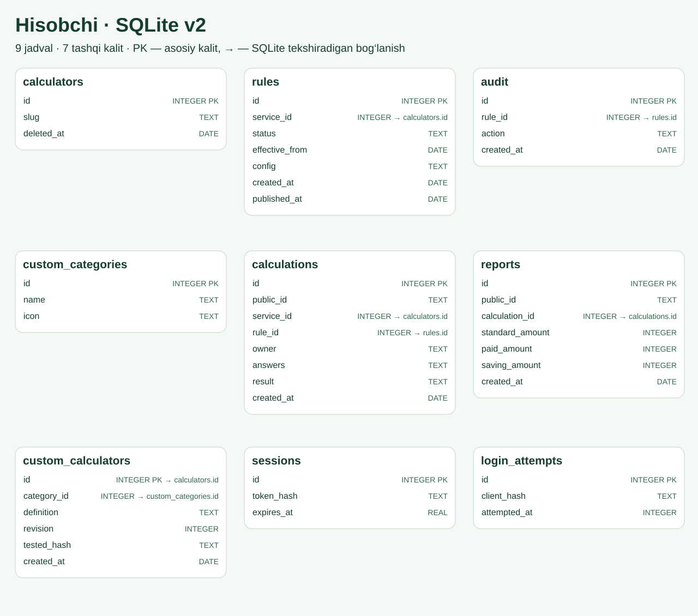
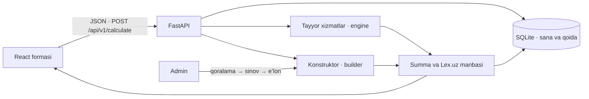

# Hisobchi MVP · dasturchilar uchun

2026-yil 21-noyabr. Ushbu hujjat jamoaga bazani tushuntirish, hisobni koddan kuzatish va yangi kompyuterda loyihani ishga tushirish uchun tayyorlandi.

## SQLite qanday tuzilgan?



| Jadval | Bir qator nimani bildiradi? | Qayerda ishlatiladi? |
|---|---|---|
| `calculators` | Bitta xizmat IDsi va arxivlangan sana | Tayyor va admin yaratgan kalkulyatorni faollashtirish yoki arxivlash |
| `custom_categories` | Toifa nomi va ikonka | Konstruktor toifalari. Dastlabki toifalar koddagi katalogdan ham keladi |
| `custom_calculators` | Admin tahrirlayotgan kalkulyatorning joriy qoralamasi | `definition` JSON ichida savollar, variantlar, formulalar, BHM va manbalar bor. `revision` bir vaqtdagi tahrirlar to‘qnashuvini aniqlaydi. `tested_hash` sinalgan qoralamaning SHA-256 qiymati |
| `rules` | Bir xizmatning muayyan sanadan qo‘llanadigan bitta qoida versiyasi | `config` JSON. Hisob sanasiga mos e’lon qilingan oxirgi versiya `effective_from DESC, id DESC` bo‘yicha olinadi |
| `audit` | Bir qoida ustida bajarilgan amal | Admin o‘zgarishlar tarixi |
| `calculations` | Bajarilgan hisob va ishlatilgan qoida | Javoblar va natija JSON ko‘rinishida saqlanadi. `owner` brauzerga berilgan tasodifiy tokenning xeshi |
| `reports` | Muayyan hisobga bog‘langan foydalanuvchi bildirgan to‘lov | `calculation_id` yagona. Bitta hisob uchun ko‘pi bilan bitta bildirish yoziladi |
| `sessions` | Bitta admin kirish sessiyasi | Token xeshi va tugash vaqti. Amal muddati to‘rt soat |
| `login_attempts` | Admin kirishidagi muvaffaqiyatsiz urinish | Mijoz manzili xeshi va vaqt orqali umumiy besh daqiqalik cheklov |

**Bog‘lanishlar.** Barcha jadvallarda asosiy kalit `id INTEGER PRIMARY KEY`. SQLite 7 ta tashqi kalitni nazorat qiladi. `rules.service_id` va `calculations.service_id` kalkulyatorga, `audit.rule_id` va `calculations.rule_id` qoidaga, `reports.calculation_id` hisobga bog‘langan. `custom_calculators.id` kalkulyatorni, `category_id` esa toifani bildiradi. API va havolalarda `slug` hamda `public_id` ishlatiladi. Yaratish, e’lon qilish va arxivlash sanalari `DATE`, ko‘rinishi YYYY-MM-DD (UTC). Sessiya va kirish cheklovi soniya aniqligida ishlaydi.

**Bazani ochish.** Odatdagi fayl — `backend/data/hisobchi.sqlite3`. Boshqa yo‘lni `HISOBCHI_DB` belgilaydi. Ulanishda `foreign_keys=ON`, bazada WAL yoqilgan. Ikki trigger e’lon qilingan qoidani yangilash yoki o‘chirishni to‘sadi. Admin yangi stavkani yangi versiyada chiqaradi. Sxema `sqlite_master`, `PRAGMA table_info` va `PRAGMA foreign_key_list` bilan solishtirildi. Git’ga foydalanuvchi yozuvlari qo‘shilmaydi.

## So‘rov qayerdan qayerga o‘tadi?



| Fayl yoki papka | Vazifasi |
|---|---|
| `backend/app/main.py` | FastAPI ilovasi, umumiy va admin yo‘llari, sessiyalar, hisobni tegishli dvigatelga yuborish |
| `backend/app/catalog.py` | Tayyor xizmatlar, savollar, variantlar va huquqiy manbalar |
| `backend/app/engine.py` | Tayyor kalkulyatorlarda savol, shart va hisob ketma-ketligi |
| `backend/app/calculator.py` | Avtomobil bitimining bazaviy hisobi |
| `backend/app/notarial.py`, `inheritance.py` | Notarial imtiyozlar, taraflarning maqomi, meros ulushi va meros hisoblari |
| `backend/app/builder.py` | Admin konstruktori, omillar, taqqoslash, BHM/foiz/summa, oldindan sinov, versiya va e’lon |
| `backend/app/models.py`, `db.py` | So‘rovlarni tekshirish, SQLite ulanishlari, jadvallar, tranzaksiyalar va qoidalarni o‘qish |
| `backend/bootstrap.py`, `traffic_presets.py` | Mahalliy admin sozlamasi va yo‘l jarimalarini admin API orqali yaratish, sinash va e’lon qilish |
| `backend/tests/` | API, konstruktor, stavkalar, imtiyozlar, manbalar va chegara qiymatlari sinovlari |
| `frontend/src/main.jsx`, `App.jsx`, `Admin.jsx` | Sahifa tanlash, ariza/chat qobig‘i, admin panel |
| `frontend/src/components/` | Kalkulyator katalogi, sonlarni formatlash, forma va natija, konstruktor, ariza va imzo maydoni |
| `frontend/src/lib/` | API chaqiruvlari, o‘zbek/rus/ingliz matnlari, omillarni filtrlash, ariza shabloni va fayllarga chiqarish |
| `frontend/vite.config.js`, `src/styles.css` | Ishlab chiqish serveri, API proksi va interfeys uslublari |

**Asosiy API.** `GET /api/v1/services` ommaviy katalogni, `GET /api/v1/calculator/schema?service_id=…` savollarni, `GET /api/v1/rules/current?service_id=…` stavkani beradi. `POST /api/v1/calculate` xizmat IDsi, javoblar va hisob sanasini qabul qiladi. API tavsifi serverdagi `/docs` va `/openapi.json` manzillarida.

**Admin oqimi.** `POST /api/v1/admin/login` → `POST /api/v1/admin/builder` → `POST /api/v1/admin/builder/{id}/preview` → `POST /api/v1/admin/builder/{id}/publish`. Tahrirlash uchun `PUT /api/v1/admin/builder/{id}`. E’lon qilishdan oldin shu versiyadagi qoralama sinaladi va Lex.uz manbasi biriktiriladi. Ommaviy forma bilan admin sinovi bitta hisoblash funksiyasini chaqiradi.

## Texnologiyalar

| Qism | Ishlatilgan vositalar |
|---|---|
| Backend | Python 3.12, FastAPI, Starlette, Uvicorn, Pydantic, python-dotenv |
| Hisob va saqlash | Python `Decimal` va `Fraction`, SQLite va standart `sqlite3` drayveri, JSON; SQL so‘rovlari parametrlar bilan bajariladi |
| Interfeys | React va React DOM 19, JavaScript/JSX, CSS, Lucide React ikonkalari, brauzer Fetch API |
| Yig‘ish va paketlar | Node.js, npm, Vite 6; Vite orqali Rollup va esbuild |
| Ariza | O‘zbek/rus shablonlari, brauzer Canvas imzo maydoni, `docx` orqali Word, `pdfmake` orqali PDF. Ariza ma’lumotlari brauzer xotirasida qayta ishlanadi |
| Tekshirish | Python pytest, FastAPI TestClient va HTTPX; frontend uchun Node test runner; interfeysni brauzerda sinash |
| Jamoa | Git va yopiq GitHub repo. Chat oynasi keyingi model integratsiyasi uchun ajratilgan |

Backendning bevosita paketlari [requirements.txt](../backend/requirements.txt), tranzitiv paketlar bilan aniq versiyalari [requirements.lock.txt](../backend/requirements.lock.txt) faylida. Frontendning bevosita paketlari [package.json](../frontend/package.json), to‘liq versiyalar daraxti [package-lock.json](../frontend/package-lock.json) faylida.

## Yo‘l jarimalari qanday hisoblanadi?

Hisob 2026-yil 1-sentabrdan amal qiladigan **440 000 so‘mlik BHM** bilan beriladi. Natija — bitta holatning to‘liq jarimasi. Erta to‘lash chegirmasi va boshqa turdagi javobgarlik bu ikki hisobga kirmaydi. [PF-115, 3-band (b)(ii)](https://lex.uz/docs/-8283656#-8283949)

| Radar qayd etgan tezlik − cheklov − 5 km/soat | BHM | Jarima |
|---|---:|---:|
| 0 yoki manfiy | 0 | 0 so‘m |
| 0 dan katta, 20 gacha, 20 ham kiradi | 1 | 440 000 so‘m |
| 20 dan katta, 40 gacha | 5 | 2 200 000 so‘m |
| 40 dan katta, 60 gacha | 9 | 3 960 000 so‘m |
| 60 dan katta | 15 | 6 600 000 so‘m |

60 km/soatlik yo‘lda radar 85 ni ko‘rsatsa, hisobga olinadigan oshish 20 km/soat, jarima 440 000 so‘m. Radar 86 ni ko‘rsatsa, oshish 21 km/soat va jarima 2 200 000 so‘m. Admin konstruktori ikki raqamli omil farqini chegara bilan solishtiradi. [MJtK 128³-modda](https://lex.uz/uz/acts/-97664#-7400359) · [5 km/soat chegirma](https://lex.uz/uz/acts/-97664#-7400397)

Taqiqlovchi signal yoki tartibga soluvchining taqiqlovchi ishorasida faqat to‘xtash chizig‘ini bosib kirish — **0,5 BHM**. Taqiqlovchi signal yoki ishorada o‘tish — **3 BHM**. Admin bitta tanlov maydonida har bir holatga alohida stavka beradi. [MJtK 128⁴-modda, 1-qism](https://lex.uz/uz/acts/-97664#-4659123) · [2-qism](https://lex.uz/uz/acts/-97664#-7400413)

## Yangi kompyuterda ishga tushirish

Loyiha ildizida PowerShell orqali quyidagilarni bajaring.

```powershell
py -3.12 -m venv backend/.venv
backend/.venv/Scripts/python.exe -m pip install -r backend/requirements.lock.txt
backend/.venv/Scripts/python.exe backend/bootstrap.py
npm.cmd --prefix frontend ci
backend/.venv/Scripts/python.exe -m uvicorn app.main:app --app-dir backend --port 8000
```

Ikkinchi terminalda `npm.cmd --prefix frontend run dev` buyrug‘ini bajaring. Sayt `http://127.0.0.1:5173`, admin panel `/admin` manzilida ochiladi. Mahalliy `ADMIN_PASSWORD` qiymati `backend/.env` faylida. Eski bazaga faqat ikkita jarimani qo‘shish uchun loyiha ildizida `backend/.venv/Scripts/python.exe backend/traffic_presets.py` yetarli. Qayta ishga tushirish mavjud e’lonlarni takrorlamaydi va arxivlangan jarimani tiklamaydi.

Sinovlar: `cd backend` papkasida `.venv/Scripts/python.exe -m pytest -q`; `frontend` papkasida `npm.cmd test` va `npm.cmd run build`.
